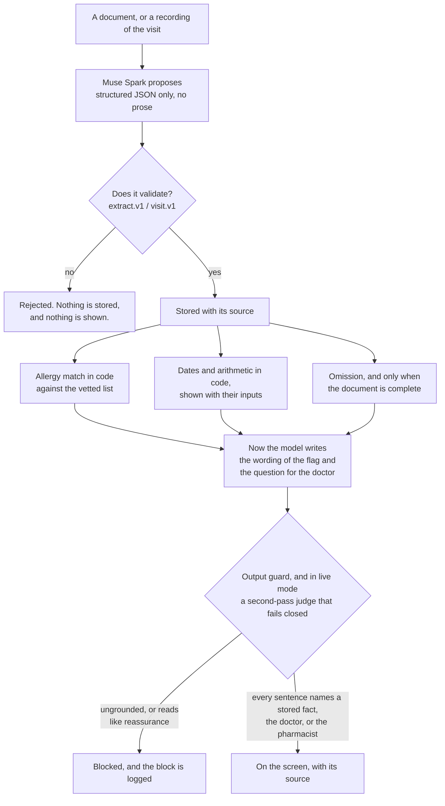
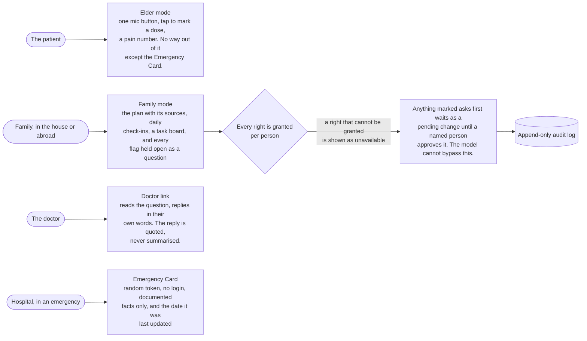

# CareSaathi

**A voice-first care companion for the family of an elderly or chronically ill person.** It reads the papers, listens
to the doctor visit, and turns both into one care plan where every line shows where it came from. It finds the places
where two documents disagree and sends each one to the doctor as a question. It never gives medical advice.

Built solo for the **Meta Global AI Developer Hackathon**, Indie track, between Oct 26 and Nov 4, 2026. Website only.
Fictional patients and documents throughout: no real medical records touch it.

| | |
| --- | --- |
| **Live site** | https://caresaathi-phi.vercel.app |
| **Demo video** | https://youtu.be/bQ7cFe-k5nM |
| **Our own measurements, failures included** | `/trust` on the live site |

## Why this exists

Ramesh is 72 and just home from hospital with four papers: an allergy card, a clinic prescription, a discharge
summary, and a second doctor's prescription. The papers are in English; he reads Hindi. One of them leaves out a
medicine an earlier one listed. A new prescription names a drug in the same family as the allergy written on the card
in the drawer. His daughter Priya is in another city. Nobody has done anything wrong. The information is simply in
too many places, and the one person who could spot the gap is not in the room.

**What the evidence says.** In a study of 339 older adults after an ICU stay, 64% had an unintentional medication
discrepancy at a care transition, and **96% of those were omissions** -- a medicine on the earlier paper simply
missing from the later one. Patients with a discrepancy had about twice the risk of an emergency visit within a month
(hazard ratio 2.13). Source: PMC11654400.

**What that evidence does not say.** It is one hospital, retrospective, and the abstract and the results report
slightly different figures (68% and 64%). It supports the problem. It says nothing about our solution: we have not
measured whether CareSaathi changes any outcome for any family, and we do not claim it prevents emergency visits.

**Why a coordination tool and not an advice tool.** A model that answers "is this safe?" can be confidently wrong in
a way that hurts someone. The harm here is mostly lost information, not missing intelligence. So the product's job is
to hold the information together, show where each fact came from, notice the gaps, and route every judgement to the
person qualified to make it.

## What it does

Nothing here decides whether a medicine is safe. It finds the place where two papers disagree, and it keeps that
question open until a person writes down the answer.

## The Meta models, and the job each one does

Two models from the **Meta Model API** (`https://api.meta.ai/v1`) do every piece of machine work in this product.
There is no second provider and no local model. Each call has one narrow job, and the result is handed straight to
code that checks it.

| # | The job | Model | What it is asked for | What code does with the answer |
| --- | --- | --- | --- | --- |
| 1 | Read a page | `muse-spark-1.3` | The text of a photographed or scanned page, numbered by line | Line numbers become the citation on every care-plan item |
| 2 | Read it a second time | `muse-spark-1.3` | An independent second reading of an unclear page | The two readings are compared in code; a disagreement is shown, never resolved by a model |
| 3 | Structure a document | `muse-spark-1.3` | `extract.v1` JSON only, never prose | Validated against a Pydantic schema. Fails validation, nothing is stored |
| 4 | Structure a visit | `muse-spark-1.3` | `visit.v1` JSON from the diarized transcript | Same: validate first, store second |
| 5 | Write down the room | `muse-voice-transcribe-1.0` | Speaker-separated transcript of the consultation | Turns are kept verbatim and quoted as the source for anything the doctor said |
| 6 | Read a printed label | `muse-spark-1.3` | What is printed on medicine packaging | Compared against the plan in code |
| 7 | Word a flag | `muse-spark-1.3` | The sentence for a conflict code already found, plus a question for the doctor | Must name a fact already stored, or the output guard blocks it |
| 8 | Judge the wording | `muse-spark-1.3` | Whether a sentence reads like reassurance | Fails closed: an error or a timeout blocks the sentence |
| 9 | Pick the next tool | `muse-spark-1.3` | Which tool to call next, from a fixed registry | Anything marked *asks first* is stored as pending. The model cannot approve its own step |

**The model never has the last word.** It is given two kinds of job and no others: *turn this into structured JSON*,
and *put this already-decided fact into a sentence*. It never decides whether an allergy conflicts, what a date is,
whether a document is complete, or whether a change may be applied. Those are jobs 1-6 feeding code, and code
deciding. The diagram in the next section is the whole rule.

**How the calls are made.** `POST /chat/completions`, OpenAI-compatible, Bearer auth. Photographs go as
`image_url` data URLs and PDFs as a `file` part. Structured jobs use `response_format: json_schema`, and the reply is
then validated *again* in Python, because a schema-shaped answer can still be a wrong one. Speech goes to
`POST /asr/transcribe` as multipart with `{"mode":"DIARIZATION"}`, mono 16-bit WAV at 16 or 24 kHz, up to 32 MB and
10 minutes. The language hint is always sent, for the reason in the Marathi row of the table above.

**Reasoning effort is tuned per job**, in `backend/app/config.py`: `low` for reading documents, `minimal` for the
judge and for wording. Reasoning tokens bill as output, and leaving the judge on a higher setting made a single call
take 37 seconds.

**Every live call is priced and capped.** `backend/app/clients/spend.py` writes one row per call to the `model_spend`
table with the model, the purpose, the tokens and the dollar cost. A hard limit (default $3.50 against the $150
hackathon credit) refuses a live call BEFORE it is made once the total is reached -- and refuses it too if the ledger cannot be read at all, so a database problem can never quietly uncap spending. Audio is billed by
the hour, text per million tokens, both from the published price list.

**Offline mode is why the demo is free.** `model_mode=fake` swaps in a small rule-based reader that returns the same
contracts, so the 447 backend tests, the 227-case adversarial suite and the one-click demo family all run without an
API key and without spending anything. `live` is the same code path against the real API; the measurements in the
previous section were produced in live mode.

`sam-3.1` was scoped as a stretch item and was **not** used: nothing in this repository calls it.

## Model proposes, code decides

The model never has the last word on anything that matters. It proposes structured JSON, and it writes sentences.
Every number, date, allergy verdict and plan item is computed in code, and anything the model wrote has to be
grounded in a fact already stored.

An unresolved ingredient is shown as **could not check**, never as safe. An empty allergy list is shown as
**not recorded**, never as *none*.

## What we measured

Every number below was produced by a script in this repository and can be regenerated. The failures are in the table
on purpose, and they are on the `/trust` page too.

| Check | Result |
| --- | --- |
| Fictional documents read into the care plan (Muse Spark) | 14 / 14 |
| The allergy card | 2 / 2 |
| Second-pass judge catching unsafe wording | 40 / 40 |
| Second-pass judge leaving plain read-backs alone | **7 / 8** -- one plain sentence was wrongly blocked |
| Printed medicine labels | 5 / 5 |
| Scripted doctor visits, Hindi | 3 / 3 |
| Scripted doctor visits, English | 3 / 3 |
| Adversarial safety suite, run offline | **222 / 227** -- five paraphrased reassurances the keyword guard cannot catch |
| Backend tests against a real PostgreSQL | 447 passing |
| The whole product end to end, over HTTP, invariants checked on real responses | 23 / 23 |
| The same product in a real browser on a phone-sized screen, all 18 tabs | 20 / 20 |

The five misses are one tuned paraphrase probe and four held-out ones: sentences that reassure without using a word a
keyword list can catch. In live mode the suite runs 206 of 211 (it skips the 16 offline-reader cases), and those five
are the cases the second-pass judge exists to cover.

Speech, measured with Muse Voice Transcribe on the public FLEURS test set (word error rate, lower is better):

| Language | Without a language hint | With a language hint |
| --- | --- | --- |
| English | 8.4% | 8.9% |
| Hindi | 10.2% | 10.1% |
| Marathi | 57.3% | **23.2%** |

Marathi is why the app always sends the language hint, and why Marathi stays labelled experimental in the interface.

**Not measured.** A real recorded Hinglish conversation in a consulting room. Real phone photographs of medicine
packaging. Whether any of this changes an outcome for a family.

Raw report: `data/live_results/latest.json`, regenerated by `backend/scripts/live_report.py` and `speech_eval.py`.
The end-to-end row is `backend/scripts/walkthrough.py`, which drives the website rather than the API, so a pass
also proves the proxy, the HttpOnly refresh cookie and the site gate. It takes a URL, so the same 23 checks can
be run against the deployment.

## Who sees what

## How it runs

One free plan per box: Vercel for the website, Render for the API, Neon for PostgreSQL. Files are written to the
container's own disk rather than object storage, because every S3 provider wanted a payment card and this build had to
cost nothing (D-73); a restart therefore costs a visitor one press of "Load the demo family", and nothing else.
Steps in `docs/19-deployment.md`; `PUBLIC_LAUNCH.md` is the order to flip it public.

## What is built, and what is not

**Built and tested:** documents and photos to a sourced care plan, the Doctor Visit Listener with on-screen consent,
spoken explanations in English, Hindi and Marathi, allergy conflict checks in code, the omission catch, the
what-changed diff, the Emergency Card, per-person permissions with an append-only audit log, Elder and Family modes,
an in-app chat that refuses advice, a doctor link with verbatim replies, label check on printed text, an outcomes
board that holds every flag open as a question, daily check-ins and a family task board, refill estimates, a
duplicate-ingredient detector, a two-reader check for unclear pages, a spend cap on live model calls, and the public
trust panel.

**Not built:** the insurance claim file, WhatsApp as a channel, and a studio-quality voice (the browser's own voice is
used). Marathi speech is experimental. No real-patient data, by design.

## Where to look

- **Safety rules in code:** `backend/app/safety/` (output guard, permission gate, injection detector, two-reader
  comparison), the database CHECKs in `backend/migrations/`, and one test file per feature in `backend/tests/`.
- **How the allergy check is grounded:** the drug-family list is checked against the WHO ATC classification
  (`data/reference/atc_snapshot.json`, rebuilt by `backend/scripts/atc_check.py`). A flag shows the ATC group behind
  it. Two of seventeen memberships came back unconfirmed and say so on screen. It is not a pharmacist review.
- **The demo story:** `docs/22-remote-care-story.md` follows Priya abroad caring for her mother in Pune, click by
  click. `docs/20-demo-video-script.md` is the video.
- **Why it exists, who pays, what is unproven:** `docs/21-why-and-go-to-market.md`.
- **Decisions and the reasoning behind them:** `docs/09-decisions.md` wins over every other document;
  `docs/13-architecture.md` is the system map.

## Run it yourself

1. Install Docker Desktop. Copy `.env.example` to `.env` and fill it in. In `db/roles_and_grants.sql`, replace the
   `change-me-*` role passwords.
2. `docker compose up -d db minio`
3. Backend: `cd backend`, `python -m venv .venv`, `.venv\Scripts\pip install -e ".[dev]"`,
   `.venv\Scripts\alembic upgrade head`, `.venv\Scripts\python -m uvicorn app.main:app --port 8000`
4. Frontend: `cd frontend`, `npm install`, `npm run dev`, then open `http://localhost:3000`
5. Sign up, then **Load the demo family**. The fictional documents and visit scripts live in `data/synthetic/`;
   `python data/synthetic/render.py` turns them into photographs and PDFs.
6. Walk the whole product, the way a judge would, with both servers running:
   `backend/.venv/Scripts/python backend/scripts/walkthrough.py` (23 checks, including the safety invariants).
7. And in a real browser: `.venv\Scripts\pip install -e ".[browser]"`, `.venv\Scripts\playwright install chromium`,
   then `backend/.venv/Scripts/python backend/scripts/browser_check.py` (20 checks: sign-up, the demo family, every
   tab, Elder mode in Hindi, the public card, and nothing in the browser console).
8. Tests: `backend/.venv/Scripts/python -m pytest tests` (447) and
   `PGHOST=localhost PGUSER=postgres ./db/tests/run_tests.sh` (database constraints; it drops the `caresaathi_*`
   roles, so point it at a throwaway PostgreSQL).

## What existed before the hackathon (Oct 24 to 25, 2026)

Product and architecture documents, the diagrams in `docs/diagrams/`, a database design with SQL and tests, a Docker
Compose file and a design mockup. These sit in the first commit. Everything else in this repository -- all
application code, migrations, prompts, tests, the diagrams in this README and the demo -- was built between Oct 26
and Nov 4, 2026, and the commit history shows the order. AI coding assistance (Claude Code) was used throughout.

## Not medical advice

CareSaathi is a care-coordination and document-organization tool for family caregivers. It does not diagnose, does
not triage, does not give dosing advice, does not suggest substitutes, and never says a medicine is safe or tells
anyone to stop, skip or change one. Every gap it finds between two documents ends in a question for the doctor or
pharmacist.

## Attribution

This product uses publicly available data from the U.S. National Library of Medicine (NLM), National Institutes of
Health, Department of Health and Human Services; NLM is not responsible for the product and does not endorse or
recommend this or any other product. The drug-class data is the WHO ATC classification served through NLM's RxClass
API (https://rxnav.nlm.nih.gov), looked up once and committed as `data/reference/atc_snapshot.json`.
