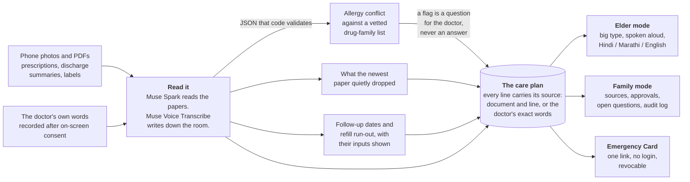
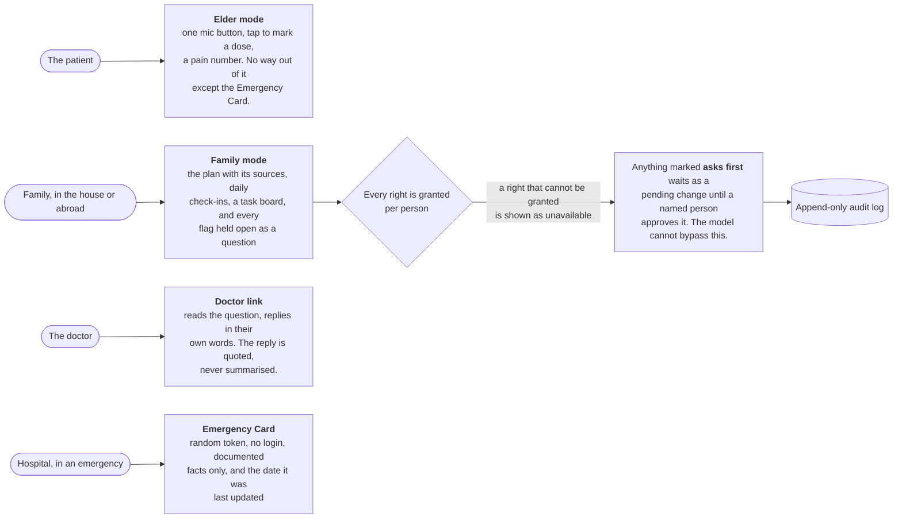
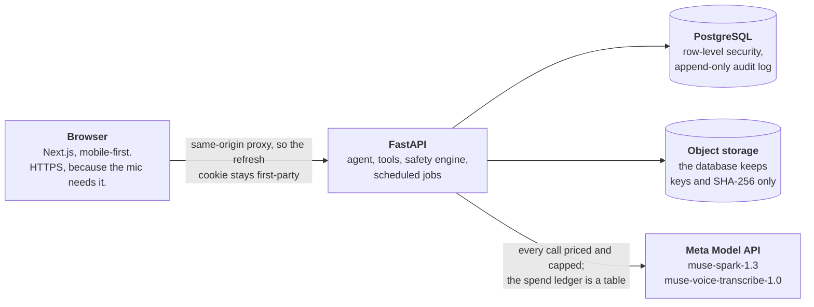

# CareSaathi

Voice-first AI care companion for families looking after an elderly or chronically ill relative. Website only. Built for the Meta Global AI Developer Hackathon (Indie track). Synthetic data only.

## What it does

Nothing here decides whether a medicine is safe. It finds the place where two papers disagree, and it keeps that question open until a person writes down the answer.

## Where it stands

Status (Oct 31, 2026): the backend and website run locally and the whole spine is built and tested: sign up, family invitations and permissions, document photos and PDFs read by Muse Spark, the sourced care plan, allergy checks in code, the omission catch, the Doctor Visit Listener (consent, mock visits, pending changes), spoken explanations and an in-app chat that refuses advice, the Emergency Card, Elder and Family modes, and a public trust panel. Stretch: follow-up tracker, refill estimates, medicine history, fridge sheet, duplicate-ingredient detector, and (added Oct 28 to 31) a doctor link with verbatim replies, a care crew with a visible step trace and visit brief, label check (printed text only; loose pills refused), a picture schedule in English, Hindi and Marathi, an outcomes board that tracks every flag as a question until a person records the answer, a spend guard on live model calls, and (Oct 31) remote-care tools: daily check-ins (a Today tab for the family and tap-to-mark doses and a pain number on the elder's screen) and a family task board. The two-reader check is wired in (it runs when the first reading reports unclear text). Not built: the claim file, WhatsApp, a text-to-speech provider (the browser voice is used), a public deployment (Dockerfiles and a guide are ready: `docs/19-deployment.md`).

How it is meant to be used: at trigger moments (a discharge, a visit, a new prescription, a refill, a follow-up), not every day. The aim is to catch a mix-up between two papers early. In one hospital study, patients with a medication discrepancy had about twice the risk of an emergency visit within a month; we do not claim CareSaathi prevents emergency visits and have not measured it.

Honest numbers: backend tests pass against a real Postgres (see the latest run in the commit history), and the adversarial suite passes 215 of 220 cases offline (206 of 211 when the server runs in live mode, which skips the offline-reader cases); the misses are paraphrased reassurances the keyword guard cannot catch, listed at `/trust`. Live Meta models (documents, labels, visits in Hindi and English, the second-pass judge) and Muse Voice Transcribe on real English, Hindi and Marathi recordings (public FLEURS test set) have been measured; the numbers, including what failed and was fixed, are in `docs/10-hackathon-facts.md` and on `/trust`. Not measured yet: a real recorded Hinglish doctor-visit conversation, and real phone photos of packaging.

## Model proposes, code decides

The model never has the last word on anything that matters. It proposes structured JSON, and it writes sentences. Every number, date, allergy verdict and plan item is computed in code, and anything the model wrote has to be grounded in a fact already stored.

An unresolved ingredient is shown as **could not check**, never as safe. An empty allergy list is shown as **not recorded**, never as *none*.

## Who sees what

## For judges: where to look

- **Product tour in one page:** `docs/20-demo-video-script.md` follows one family through every feature. The system map and the decisions behind it are in `docs/13-architecture.md` and `docs/09-decisions.md` (D-01 to D-64).
- **The demo story (remote care):** `docs/22-remote-care-story.md` follows Priya in Toronto caring for her mother in Pune, step by step.
- **Why it exists and who it is for:** `docs/21-why-and-go-to-market.md` covers the problem, the first customer, positioning, go to market, the global plan, risks and what is not proven.
- **Evidence, including failures:** the Trust page (`/trust` in the running app) shows the safety suite and the live Meta-model measurements: documents, allergy card, labels, scripted visits in Hindi and English, the second-pass judge in both directions, and Hindi, Marathi and English speech on real recordings. The raw report is `data/live_results/latest.json`; `backend/scripts/live_report.py` and `speech_eval.py` regenerate it.
- **How the allergy check is grounded:** the drug-family list is checked against the WHO ATC classification (`data/reference/atc_snapshot.json`, rebuilt by `backend/scripts/atc_check.py`). A family flag shows the ATC group behind it. Two of seventeen memberships came back unconfirmed and say so on the screen. It is not a pharmacist review (D-63).
- **Safety rules in code:** `backend/app/safety/` (output guard, permission gate, injection detector, two-reader comparison), the database CHECKs in `backend/migrations/`, and one test file per feature in `backend/tests/` (447 tests).
- **What is new work:** everything outside the files listed under "What existed before the hackathon" below. The commit history shows the order.
- **What is not done:** the claim file, WhatsApp, a studio-quality voice (the browser voice is used), and real-patient data. Marathi speech is experimental.

## How it runs

One free plan per box: Vercel for the website, Render for the API, Neon for Postgres, Cloudflare R2 for files. The steps are in `docs/19-deployment.md`, and `PUBLIC_LAUNCH.md` is the order to flip it public.

## What existed before the hackathon (Oct 24 to Oct 25, 2026)

Product and architecture documents, the diagrams in `docs/diagrams/`, a database design with SQL and tests, a Docker Compose file and a design mockup. These are in the first commit. Everything else in this repository, including all application code, migrations, prompts, tests and the demo, is built between Oct 26 and Nov 4, 2026. AI coding assistance (Claude Code) is used.

CareSaathi is a care-coordination and document-organization tool for family caregivers. It does not give medical advice.

## Start here

1. Read `CLAUDE.md` (Claude Code reads it automatically).
2. Install Docker Desktop. Copy `.env.example` to `.env` and fill in the passwords.
3. In `db/roles_and_grants.sql`, replace the `change-me-*` role passwords before the first start.
4. `docker compose up -d db minio`
5. Check: `docker compose exec db psql -U postgres -d caresaathi -c "\dt"`
6. Database tests (need the `psql` client): `PGHOST=localhost PGUSER=postgres ./db/tests/run_tests.sh` (it drops the `caresaathi_*` roles, so run it only against a throwaway Postgres)
7. Backend: `cd backend`, `python -m venv .venv`, `.venv\Scripts\pip install -e ".[dev]"`, `.venv\Scripts\alembic upgrade head`, `.venv\Scripts\python -m uvicorn app.main:app --port 8000`. Tests: `.venv\Scripts\python -m pytest tests` (API tests use a scratch database cloned from your dev schema).
8. Frontend: `cd frontend`, `npm install`, `npm run dev`, then open `http://localhost:3000`.
9. Demo data: sign up, then "Load the demo family". Synthetic documents and visit scripts live in `data/synthetic/`; `python data/synthetic/render.py` makes photos and PDFs for the live reader; `backend/scripts/live_smoke.py` measures the live models.

## Docs

`docs/09-decisions.md` wins over every other file. `docs/05-scope.md` defines the spine and the gates.

Last database test run: all passed (schema checks and row-level security checks).

## Attribution

This product uses publicly available data from the U.S. National Library of Medicine (NLM), National Institutes of Health, Department of Health and Human Services; NLM is not responsible for the product and does not endorse or recommend this or any other product. The drug-class data is the WHO ATC classification served through NLM's RxClass API (https://rxnav.nlm.nih.gov), looked up once and committed as `data/reference/atc_snapshot.json`.
