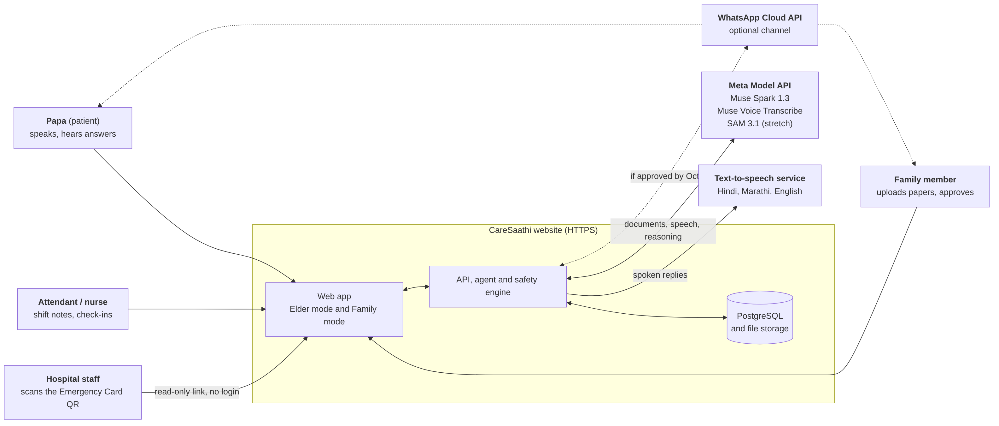
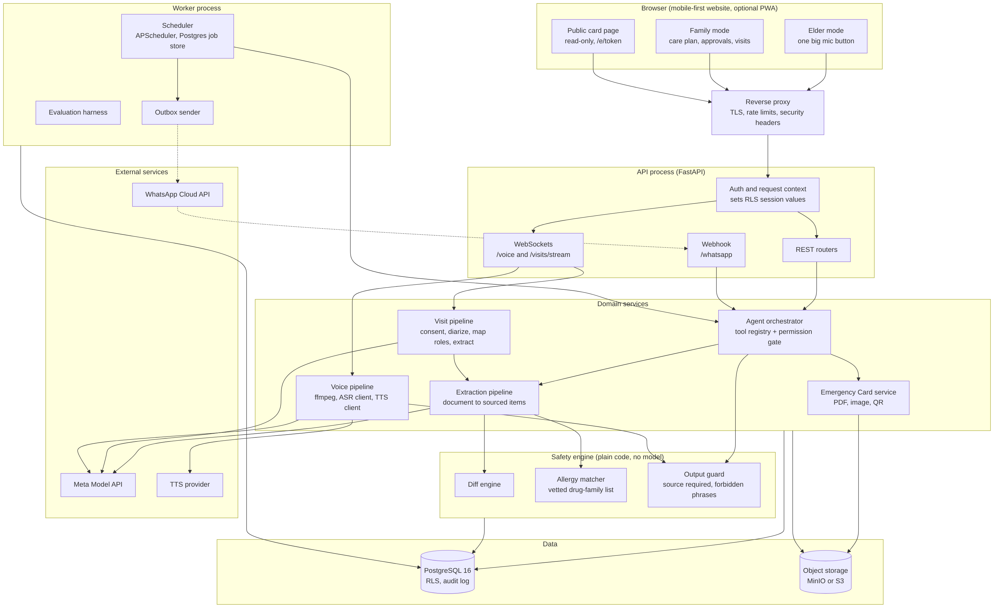
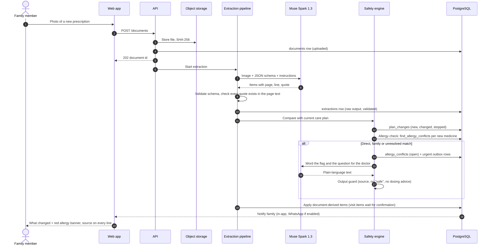
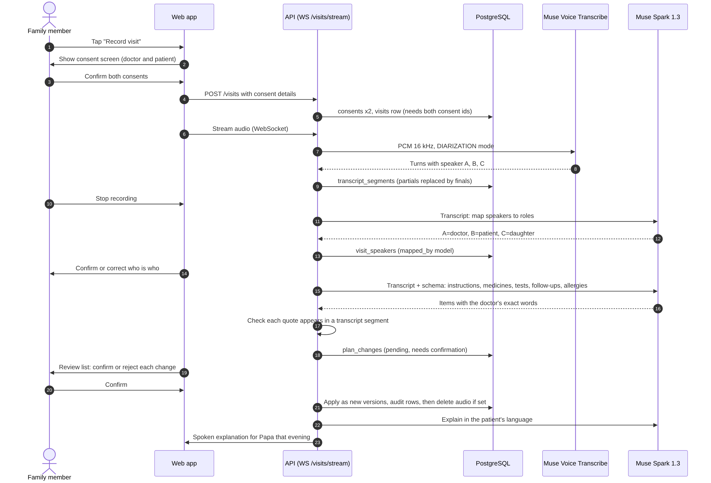
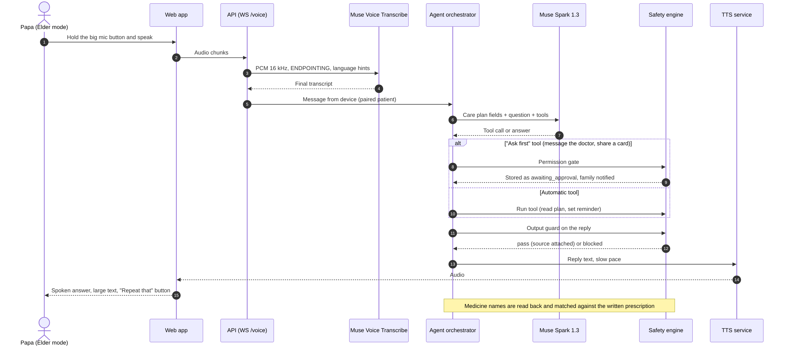
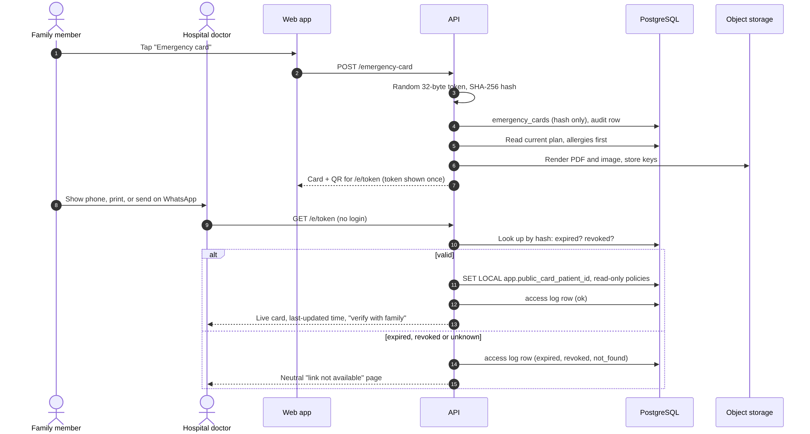
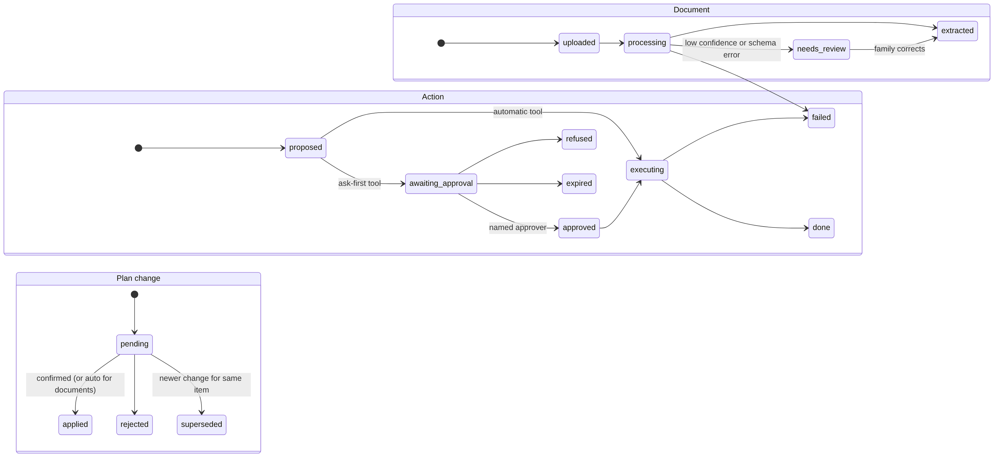
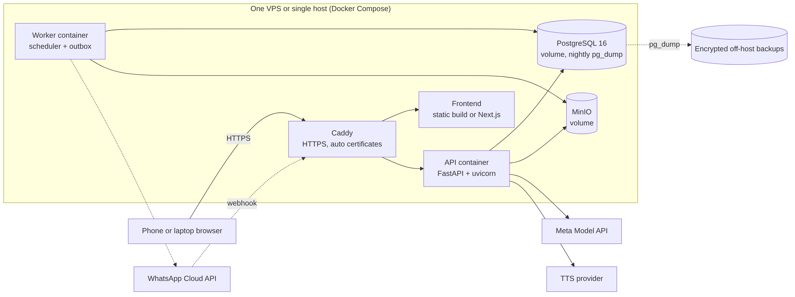

# Architecture

How CareSaathi is built: the pieces, how they talk, and what keeps it safe and running. Diagram sources are in `diagrams/src/*.mmd` (Mermaid); rendered PNGs sit beside them. If you change a flow, change the diagram source and re-render.

Related: `02-architecture.md` (original model mapping and tool list), `09-decisions.md` (D-xx), `14-data-mapping.md`, `15-api-spec.md`, `16-database-design.md`.

## 1. Goals and qualities

| Quality | What it means here | How it is met |
| --- | --- | --- |
| Safe by construction | The product never says a medicine is safe, never changes a medicine, never skips an approval | Rules in code and database, not only in prompts; automated adversarial tests |
| Traceable | Anyone can check where a fact came from in seconds | `source_refs` on every item and output; "show source" in the UI |
| Voice first | A patient who cannot read or type can use it | Elder mode, speech in and out, read-back of medicine names |
| Works with unreliable inputs | Blurry scans, mixed languages, noisy clinics | Validation and `needs_review` paths; unknown stays unknown |
| Explainable cost | Judges and the owner can see what each feature costs | `model_calls` with tokens, latency and cost |
| Recoverable | A model or network failure must not lose data or stall the demo | Outbox, retries, stored raw outputs, recorded demo backups |
| Long-lived | Foundation for a real service | Postgres, migrations, versioned history, RLS, audit log, portable Docker deployment |

Targets to measure (not promises): voice reply latency, extraction accuracy on the 20-document set, instruction recall on the 3 mock visits, zero safety failures on the 30 adversarial prompts. Numbers are recorded in `eval_runs` and published honestly with failures.

## 2. System context



People: the patient (Elder mode), family members, attendants and nurses (Family mode), and hospital staff (public read-only card). External services: Meta Model API, a text-to-speech service, and optionally the WhatsApp Cloud API. Delivery is a website only (D-17).

## 3. Containers



| Container | Technology | Responsibility |
| --- | --- | --- |
| Web app | React or Next.js, mobile-first, optional PWA | Elder mode, Family mode, public card page. No business rules |
| Reverse proxy | Caddy (automatic HTTPS) | TLS, security headers, rate limits, static files |
| API | Python, FastAPI | Auth, request context, REST, WebSockets, webhooks |
| Domain services | Python modules in the API and worker | Agent orchestrator, extraction, voice, visit, emergency card |
| Safety engine | Plain Python plus SQL functions | Diff engine, allergy matcher, output guard, permission gate. No model calls inside |
| Worker | Python, APScheduler (Postgres job store) | Reminders, check-ins, briefings, outbox sending, retention jobs, evaluation runs |
| PostgreSQL 16 | Docker volume | System of record, RLS, audit log |
| Object storage | MinIO (S3 API) | Documents, photos, audio, PDFs and card images |

The API and worker run the same codebase in two processes with different database roles (`16-database-design.md`, section 5).

## 4. Key flows

### 4.1 Document to care plan, with allergy check



1. The file is stored and hashed. The API answers at once and extraction runs in the background.
2. Muse Spark 1.3 returns `extract.v1` JSON. Code validates it and verifies that each quote exists in the page text.
3. The diff engine compares new items with the current plan and writes `plan_changes`.
4. For each new or changed medicine, `find_allergy_conflicts` runs in SQL. A match, or an ingredient the list cannot resolve, opens an `allergy_conflicts` row and queues urgent outbox messages.
5. Muse Spark words the flag and the question for the doctor. The output guard checks the wording before anyone sees it.
6. Document-derived changes are applied as new versions. The family sees what changed, with a red allergy banner and a source on every line.

### 4.2 Doctor Visit Listener



Consent from the doctor and the patient (or a family member on the patient's behalf) is stored first; the visit row cannot exist without both. Audio streams to Muse Voice Transcribe in diarization mode, which labels speakers `A`, `B`. Spark proposes roles; the family corrects them. Extraction cites segment ids, and each quote is checked against those segments. Changes wait as `pending` until a family member confirms. Audio is deleted after transcription unless the family chose to keep it.

### 4.3 Elder voice loop



A paired phone authenticates as the patient only. Speech goes to Muse Voice Transcribe, the agent answers using only stored care plan fields, and any "ask first" tool becomes an approval request for a family member. Replies are guarded, then spoken by the TTS service. Medicine names are read back and matched against the written prescription.

### 4.4 Emergency Card



The token is random and shown once; only its SHA-256 hash is stored. The public route validates the token, sets a read-only database context for that one patient, logs the access, and renders live data with a "last updated" time. Expired, revoked and unknown tokens all get the same neutral page.

### 4.5 State machines



## 5. Agent design

The agent is a loop around Muse Spark 1.3 with function calling. The model chooses tools; the backend decides what is allowed.

1. **Context assembly.** Only the care plan fields needed for the request, the allergy state, and the last few messages. The full history is never pasted by default (D-14).
2. **Model turn.** The model may reply or call tools (parallel calls are supported by the platform).
3. **Permission gate.** For each tool call the backend looks up the tool's permission. `A` runs. `AF` is stored as `awaiting_approval`, family members are notified, and the model is told "pending approval". `AA` runs and alerts. An unknown tool is refused.
4. **Guard.** The final reply goes through the output guard (`15-api-spec.md`, section 7). A blocked reply is replaced by a safe fallback.
5. **Record.** `agent_runs`, `actions`, `generated_outputs`, `output_sources`, `model_calls` and `audit_log` rows are written.

Prompt rules (kept in version-controlled prompt files, with tests):

- The system prompt states the safety rules, but nothing depends on the model obeying them.
- Document and transcript text is passed inside delimited data blocks and described as untrusted. The model may not call tools because a document told it to; tool calls are accepted only in agent turns triggered by a user message, a schedule or a system event.
- Extraction prompts return JSON only, matching `extract.v1` or `visit.v1`.
- Explanation prompts receive stored fields and must cite `source_ref_id`s; the guard rejects outputs that cite nothing.

## 6. Security architecture

| Area | Design |
| --- | --- |
| Trust boundaries | Browser to proxy to API to database. The model and external services are outside the trust boundary: their output is data to validate. |
| Authentication | Argon2id passwords, short-lived access tokens, rotating refresh cookie (HttpOnly, Secure, SameSite). Paired devices use a hashed device token a family member approved. |
| Authorization | Role checks in the API plus row-level security in the database. The database is the last line of defense. |
| Emergency Card links | 256-bit random token, SHA-256 hash stored, expiry and revocation, neutral errors, rate limits, access log. No patient data in the URL. |
| Uploads | Verify type by signature, enforce size limits, store under random keys, serve through short-lived signed URLs, never execute or render uploads inline. |
| Prompt injection | Document text cannot trigger tools; outputs are schema-validated and guarded; the agent has no tool that changes medicines. |
| Secrets | Environment variables from a secrets store, never in the repository. `.env.example` lists names only. Separate secrets for the API, auth and worker roles. |
| Web | Strict Content-Security-Policy, HSTS, CORS limited to the site origin, CSRF protection on cookie-authenticated routes. |
| Logging | Structured logs with request ids. No document text, transcripts or tokens in logs. Hash IPs before storing. |
| Privacy | Synthetic data only for the hackathon (D-13). Contributor-mode models (Meta may train on prompts) are used only with synthetic data. |
| WhatsApp | Verify the `X-Hub-Signature-256` header, deduplicate on message id, map senders by phone number to members, ignore unknown senders. |
| Audit | Every approval, allergy change, consent, share and card access writes an `audit_log` row, optionally hash-chained. |

## 7. Reliability

| Concern | Approach |
| --- | --- |
| Model timeout or error | Store the failure in `model_calls`, retry with backoff for idempotent steps, mark the document `failed` or `needs_review`, tell the family plainly. Never invent a result. |
| Duplicate requests | `Idempotency-Key` on creates, unique `sha256` on documents, unique `wa_message_id`, outbox `dedupe_key`. |
| Lost notifications | Transactional outbox: the message row commits with the change, a worker sends it with retries and a dead-letter state. |
| Partial pipeline failure | Each step stores its output; the pipeline can resume from `extractions.raw_output` without calling the model again. |
| Streaming drops | The visit client keeps the recording locally and reconnects; segments are idempotent on `(visit_id, turn_id)`. |
| Network or API failure during the demo | Recorded backup clips for every demo step (plan, section 14). |
| Degraded modes | No WhatsApp: in-app chat styled as a future-plan preview (D-10). No Marathi TTS: Hindi or English voice with Marathi text on screen. No TTS at all: text and visual output. |

## 8. Observability

| Signal | Source |
| --- | --- |
| Request logs with `X-Request-Id` | API |
| Model usage, latency and cost | `model_calls` (dashboard query for the Day 4 credit check) |
| Safety events | `generated_outputs.guard_status = 'blocked'`, `allergy_conflicts`, `actions.status = 'refused'` |
| Evaluation numbers | `eval_runs`, `eval_results` |
| Health | `/healthz`, `/readyz`, container health checks |

## 9. Deployment



One Docker Compose file runs Caddy, the frontend, the API, the worker, PostgreSQL and MinIO on a single VPS, with nightly encrypted `pg_dump` to off-host storage. Microphone access needs HTTPS, so deploy with a real certificate early and test on a real phone. The same file runs on a laptop for development. `docker-compose.yml` and `.env.example` are in the repository root.

## 10. Configuration

| Variable | Purpose |
| --- | --- |
| `DATABASE_URL_APP`, `DATABASE_URL_AUTH`, `DATABASE_URL_WORKER` | One connection string per database role |
| `S3_ENDPOINT`, `S3_ACCESS_KEY`, `S3_SECRET_KEY`, `S3_BUCKET` | Object storage |
| `META_API_KEY`, `META_API_BASE` | Meta Model API (`https://api.meta.ai/v1`) |
| `META_SPARK_MODEL`, `META_SPARK_DEV_MODEL`, `META_ASR_MODEL` | `muse-spark-1.3`, the Contributor variant for synthetic-data development, `muse-voice-transcribe-1.0` |
| `TTS_PROVIDER`, `TTS_API_KEY` | Chosen after the Marathi and Hindi voice test (D-08) |
| `WHATSAPP_TOKEN`, `WHATSAPP_PHONE_ID`, `WHATSAPP_APP_SECRET`, `WHATSAPP_VERIFY_TOKEN` | Optional channel |
| `JWT_SECRET`, `TOKEN_PEPPER` | Signing and hashing secrets |
| `PUBLIC_BASE_URL` | Used in Emergency Card links and QR codes |
| `ALLOW_CONTRIBUTOR_MODELS` | `true` only when all data is synthetic |
| `REFERENCE_LIST_REQUIRE_REVIEW` | `true` blocks allergy checks for non-synthetic patients while any family used is unreviewed |

## 11. Repository layout

```
caresaathi/
  CLAUDE.md
  docs/                    all documentation, diagrams/ holds Mermaid sources and PNGs
  db/                      schema.sql, roles_and_grants.sql, seed_drug_families.sql, tests/
  backend/
    app/
      api/                 routers, WebSocket handlers, webhook, dependencies (auth, request context)
      agent/               orchestrator, tool registry, permission gate, prompts/
      pipelines/           extraction, visit, voice, emergency_card
      safety/              diff engine, allergy matcher, output guard, level rules
      clients/             meta (spark, asr, sam), tts, whatsapp, storage
      models/              SQLAlchemy models, Pydantic contracts (extract.v1, visit.v1)
      worker/              scheduler, outbox, retention, evaluation
    migrations/            Alembic
    tests/
  frontend/                Elder mode, Family mode, public card page
  data/synthetic/          Ramesh's documents, mock visits, expected answers
  docker-compose.yml
  .env.example
```

## 12. Test strategy

| Layer | What | Where |
| --- | --- | --- |
| Database | Constraints, triggers, allergy logic, RLS, privileges | `db/tests/run_tests.sh` (69 checks, passing) |
| Unit | Normalization, dosing notation parser, level rules, output guard phrase lists (English, Hindi, Marathi) | `backend/tests/` |
| Contract | `extract.v1` and `visit.v1` validators with good and bad model outputs | `backend/tests/` |
| Pipeline | The 20 synthetic documents and 3 mock visits, scripted, with expected answers | `data/synthetic/` plus evaluation harness |
| Safety | 30 adversarial prompts against agent and guard, target zero failures | evaluation harness |
| End to end | Upload, extract, flag allergy, approve, emergency card, on a phone | Playwright, recorded as demo backup |

## 13. Known risks in the architecture

| Risk | Mitigation |
| --- | --- |
| Hosted Spark may not accept images or PDFs the way the plan assumes | First thing tested on Day 1. Fallback: open-weights Muse Spark through a hosting provider, or OCR then text |
| Marathi transcription quality unknown | Test early; Hindi is the headline language until Marathi is proven (D-03) |
| Diarization fails on overlapping speech | Clean mock visits for the demo; unclear segments shown to the family; stated in the README |
| TTS quality in Marathi | Test before Day 1; fall back to Hindi voice with Marathi text |
| WhatsApp setup time and template rules | Decision gate Oct 29; preview mode as a fallback |
| Reference drug list unreviewed | Banner, no real-patient checks, ask a pharmacist to review |
| Solo build load | Spine only (`05-scope.md`); every stretch item has a cut order |

## 14. Additions after kickoff (S10 and Stretch A)

These pieces are built after Oct 26 (D-25). They reuse the existing containers: no new service is needed, only new modules in the API and worker.

### 14.1 New modules

| Module (under `backend/app/services/`) | Job | Uses the model? |
| --- | --- | --- |
| `reconciliation` | Compare ingredient sets between the earlier plan and a new document; raise omission flags; skip flags when the document looks incomplete | No. Spark only words the question |
| `derived_dates` | Follow-up due dates, refill run-out estimates, claim deadline reminders | No |
| `dual_reader` | Run two independent extractions and diff the results field by field | Yes (two calls) |
| `claim_file` | Tag documents by type, match them to the checklist, check mismatches, build the indexed PDF | Spark for tagging, code for the rest |
| `print_renderer` | Render the large-print fridge sheet from the confirmed plan (HTML to PDF) | Spark only for wording in the chosen language |
| `trace` | Keep the model draft, the guard report and the final text for "show your work" | No |
| `arena` | Rate-limited endpoint for judges' unsafe prompts, running the same agent and output guard on synthetic data | Yes |
| `duplicates` | Same-ingredient check across current items | No |

### 14.2 Flows

**Omission catch.** A new document finishes extraction. The completeness check looks for page markers ("page 1 of 2") and for pages with no extracted content. If the document looks incomplete, the job stops and shows a notice. Otherwise `reconciliation` compares the ingredient sets of the current plan and the new items. Each medicine present before and absent now becomes a flag with both sources. Spark words the question for the doctor. The output guard runs before display.

**Two-reader check.** The document is sent twice with different prompt variants. Both outputs are validated against `extract.v1`. Fields that differ (see `14-data-mapping.md`, section 14) are stored as a `second_reads` row. The item waits for a person to choose and is not applied silently.

**Claim file.** The family opens the claim file for an admission. Each uploaded document is tagged with a `document_type`. The checklist matcher marks present and missing items. The mismatch checker compares patient name, admission and discharge dates, and bill totals against the discharge summary. The builder numbers the documents and renders one PDF with a table of contents. Originals are untouched. The PDF is stored in object storage and served by a short-lived link.

### 14.3 Security notes

- The claim PDF holds personal data. It is served by a presigned link that expires, and every download is written to `audit_log`.
- The arena accepts only synthetic data, is rate limited per IP, and its attempts are stored apart from real conversations.
- Derived dates show their inputs. A derived item is never applied without a named confirmation.

### 14.4 New configuration

| Variable | Purpose |
| --- | --- |
| `SECOND_READ_ENABLED` | Turn the two-reader check on or off (it doubles the model cost per document) |
| `ARENA_ENABLED` | Show the "try to break it" page |
| `ARENA_RATE_LIMIT` | Requests per minute per IP |

### 14.5 Repository layout additions

```
backend/app/services/{reconciliation,derived_dates,dual_reader,claim_file,print_renderer,trace,arena,duplicates}.py
backend/migrations/versions/   one migration per planned table group (16-database-design.md, section 9)
frontend/src/{claim-file,fridge-sheet,trust-panel,history}/
```
